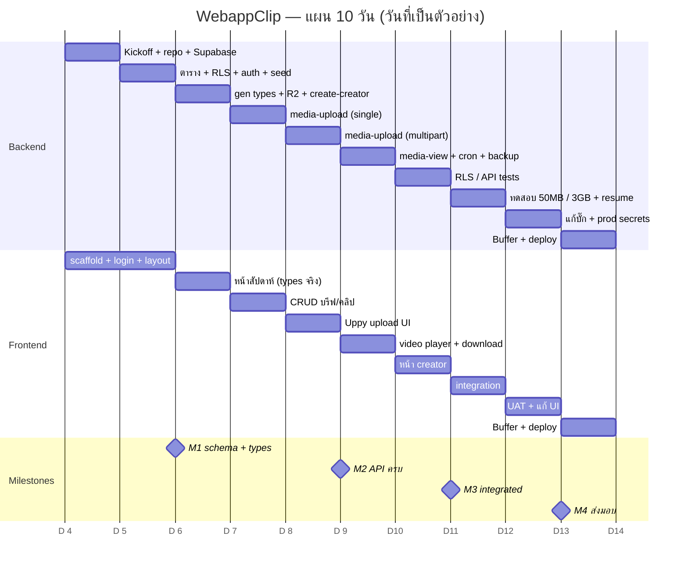

# WebappClip — System Design

> สถานะ: Draft v2 · อัปเดต 2026-11-03 · **Phase: Demo (Supabase Free + R2)**
> Backend: (ผู้ใช้) · Frontend: เพื่อน
> **v2 เปลี่ยนอะไร:** แก้ตารางต้นทุน (§8) · R2 key แยกตาม purpose + lifecycle ต่อ prefix (§4, §6.3) · เพดานขนาดไฟล์ส่งงาน (§1, §6.1, §7) · `media-view` แบบ batch (§6.2) · เพิ่มแผนงาน (§13)

## 0. Context
- เจ้าของช่องสั่งงานคลิปให้ครีเอเตอร์ผ่าน LINE → ข้อความหาย ย้อนดูยาก ตรวจงานยาก
- ปริมาณ: 1–2 → 5 → 50–70 คลิป/วัน · Deadline 7–10 วัน
- **เปลี่ยนจากบรีฟเดิม:** ต้องรองรับวิดีโอจำนวนมาก (บรีฟเดิมบอกไม่รองรับ) → แจ้งลูกค้าเรื่องสโคป/ราคา
- **สโคป:** ระบบ "สั่งงาน + เก็บไฟล์ + ตรวจงาน" ไม่ใช่เครื่องมือตัดต่อวิดีโอในเว็บ

## 1. Requirements
| | owner | creator |
|---|---|---|
| บรีฟ/คลิป/ประเภท | CRUD | อ่านอย่างเดียว |
| ไฟล์อ้างอิง (reference) | อัป/ลบ | ดู |
| ไฟล์ส่งงาน (submission) | ดู/ลบ | อัปของตัวเอง, **ลบ/แก้ไม่ได้** |
| ผู้ใช้ | สร้าง creator | — |

- ขนาดไฟล์ไม่แน่นอน: คลิปสั้น <200MB → ฟุตเทจดิบ 4K หลาย GB
- **ไฟล์ส่งงาน = ไฟล์ที่ตัดต่อเสร็จแล้ว (H.264 ≤1080p) ไม่ใช่ฟุตเทจดิบ** · เพดานขนาดต่อไฟล์เริ่มต้น **2 GB** (ปรับได้ที่ Edge Function — ต้องยืนยันกับลูกค้า, ดู §12) · ตัวคูณต้นทุนหลักคือขนาดไฟล์เฉลี่ย (§8)
- เก็บไฟล์ 30 วันแล้วลบอัตโนมัติ (ตั้งแยกตามประเภทไฟล์ได้ — §6.3)
- สิทธิ์ต้องล็อกที่ DB ไม่ใช่แค่ซ่อนปุ่ม

## 2. Tech Stack
| Layer | เลือก | เหตุผล |
|---|---|---|
| Frontend | React + Vite + TS + Tailwind (+ shadcn/ui, TanStack Query, React Router, date-fns, Uppy) | |
| DB / Auth / API | **Supabase Free** (Postgres + RLS + Auth + Edge Functions) | RLS = ล็อกสิทธิ์ที่ DB, Postgres ย้ายออกได้ · อัป Pro ได้ทีหลังโดยไม่แก้โค้ด |
| File storage | Cloudflare R2 (ฟรี 10GB) | egress ฟรี, $0.015/GB เกินโควตา, multipart ไฟล์ใหญ่, lifecycle ลบอัตโนมัติ |
| Backup | GitHub Actions `pg_dump` ทุกคืน | แทน backup ของ Pro, ฟรี |
| Hosting | Vercel หรือ Cloudflare Pages | ฟรี, preview ทุก PR |
| Repo | GitHub monorepo (private, ใต้ Organization) | |

## 3. Architecture
```
┌──────────────────────────────┐
│  Browser (owner / creator)   │
│  React + Vite + Uppy         │
└──┬───────────┬───────────┬───┘
   │ ① login   │ ② data    │ ④ upload/view ตรง (presigned URL)
   ▼           ▼  (RLS)    ▼
┌──────────────────────┐   ┌───────────────────────┐
│      SUPABASE        │   │    CLOUDFLARE R2      │
│ Auth (ปิด signup)     │   │  private bucket       │
│ Postgres + RLS       │   │  lifecycle ต่อ prefix   │
│ pg_cron              │   │  CORS เฉพาะ domain     │
│ Edge Functions ──────┼──►│                       │
│  create-creator      │ ③ presign (เก็บ secret ฝั่ง server)
│  media-upload        │   └───────────────────────┘
│  media-view          │
└──────────────────────┘
```
หลักการ: Supabase = ข้อมูล + ผู้ตัดสินสิทธิ์ · R2 = เก็บไฟล์ · ไฟล์ไม่ผ่าน server ของเรา

## 4. Data Model
```
auth.users ─1:1─ profiles(id, role owner|creator, display_name)

categories(id, name, position)
   └─1:N─ clips(id, date, position, category_id, title, script, note, created_by, updated_at)
             └─1:N─ clip_media(id, clip_id, kind image|video, purpose reference|submission,
                               r2_key, mime, size_bytes, status pending|ready,
                               uploaded_by, created_at, expires_at)
```
- ใช้ `date` แทนตาราง weeks · `position` = ลำดับในวัน
- หน้าสัปดาห์: `clips where date between จันทร์ and อาทิตย์ order by date, position`
- **R2 key: `{purpose}/{yyyy-mm-dd}/{clip_id}/{media_id}-{filename}`** (ขึ้นต้นด้วย purpose เพื่อให้ตั้ง lifecycle แยก prefix ได้ — เช่น `reference/`, `submission/`)
- `size_bytes` ใช้รวมเป็นยอดพื้นที่ที่ใช้อยู่ (view `storage_usage` สำหรับ owner)

## 5. Permissions (RLS)
| ตาราง | owner | creator |
|---|---|---|
| profiles | อ่าน (สร้างผ่าน Edge Fn) | อ่าน, แก้ role ไม่ได้ |
| categories | CRUD | SELECT |
| clips | CRUD | SELECT |
| clip_media | CRUD | SELECT, INSERT เฉพาะ `purpose='submission' AND uploaded_by=auth.uid()`, UPDATE เฉพาะ status ของตัวเอง, DELETE ไม่ได้ |

- `is_owner()` security definer → ใช้ในทุก policy (กัน recursion บน profiles)

## 6. Flows
### 6.1 Upload
```
Browser ─► media-upload {clip_id, purpose, filename, mime, size}
           ├ ตรวจ mime + size ≤ เพดาน (เกิน = 413)
           ├ INSERT clip_media ด้วย JWT ผู้ใช้ → RLS ตัดสิน (ไม่ผ่าน = 403)
           ├ size < 100MB → presigned PUT
           └ size ≥ 100MB → multipart (part ~50MB) + presign แต่ละ part
Browser ═══ Uppy อัปตรงไป R2 (resume ได้) ═══►
Browser ─► complete → CompleteMultipartUpload → status = ready
```
- Edge Fn ไม่เขียนกฎสิทธิ์ซ้ำ ใช้ RLS เป็นแหล่งเดียว
- ใช้ `aws4fetch` ใน Deno
- ขอ presign หลาย part ใน 1 request (batch) เพื่อลดจำนวน invocation (Free = 500K ครั้ง/เดือน)

### 6.2 View
```
Browser ─► media-view {media_ids: [...]} (JWT + RLS SELECT) ─► presigned GET อายุ 1 ชม. ─► <video src>
```
- **รับ id เป็นชุด (batch)** และให้ frontend เรียกเฉพาะตอนกดเล่น/เปิดคลิป ไม่ presign ทุก thumbnail ตอนโหลดหน้าสัปดาห์
- mp4/H.264 เล่นได้ทันที · ไฟล์ที่เบราว์เซอร์เล่นไม่ได้ (ProRes ฯลฯ) → ปุ่มดาวน์โหลด

### 6.3 Lifecycle
- วัน 0: อัป → pending → ready
- วัน 30 (ค่าเริ่มต้น): R2 lifecycle ลบ object ตาม prefix (`reference/`, `submission/` ตั้งอายุแยกกันได้) · pg_cron ลบแถว `expires_at < now()`
- multipart ค้าง > 1 วัน → abort อัตโนมัติ

### 6.4 สร้าง creator
```
owner ─► create-creator ─► ตรวจ is_owner ─► auth.admin.createUser (service role) ─► profiles(role=creator)
```

## 7. Security
- `service_role`, R2 keys อยู่ใน Supabase secrets เท่านั้น · frontend ถือแค่ anon key
- R2 private · ไม่มี public URL · presigned หมดอายุเอง
- จำกัด mime + ขนาดสูงสุดที่ Edge Fn
- creator ลบ/แก้ไฟล์ส่งงานไม่ได้ (หลักฐาน)
- Secrets: `R2_ACCOUNT_ID`, `R2_ACCESS_KEY_ID`, `R2_SECRET_ACCESS_KEY`, `R2_BUCKET`

## 8. Cost
> ราคาตรวจเมื่อ 2026-11-03 จากแหล่งรอง (ไม่ใช่หน้าทางการ) → **ยืนยันที่ cloudflare.com/r2 และ supabase.com/pricing ก่อนเสนอลูกค้า**
> R2: $0.015/GB-เดือน · ฟรี 10 GB, Class A 1 ล้าน, Class B 10 ล้านครั้ง/เดือน · egress ฟรี
> Supabase Free: DB 500 MB, Edge Function 500K ครั้ง/เดือน · Pro $25: DB 8 GB, 2M ครั้ง

### 8.1 Demo (1–2 คลิป/วัน)
| ส่วน | ค่าใช้จ่าย |
|---|---|
| Supabase Free | $0 |
| R2 (คลิป ~100 MB × 1–2/วัน × 30 วัน ≈ 3–6 GB ค้าง) | $0 (อยู่ในโควตา 10 GB) |
| Backup (GitHub Actions) / Hosting | $0 |
| **รวม** | **$0** |

ที่ 5 คลิป/วัน (100 MB) พื้นที่ค้าง ~15 GB เกินโควตา แต่ส่วนเกินคิดเป็นเซนต์ ไม่ใช่กำแพง

### 8.2 Production (70 คลิป/วัน, เก็บ 30 วัน → ค้างในระบบ ~2,100 คลิป)
| ขนาดเฉลี่ย/คลิป | เขียน/วัน | ค้างใน R2 | R2/เดือน | รวม + Supabase Pro |
|---|---|---|---|---|
| 100 MB (คลิปสั้น) | 7 GB | 210 GB | ~$3 | ~$28 |
| 200 MB | 14 GB | 420 GB | ~$6 | ~$31 |
| 1 GB | 70 GB | 2.1 TB | ~$31 | ~$56 |
| 3 GB (4K) | 210 GB | 6.3 TB | ~$94 | ~$119 |
| 5 GB (4K ดิบ) | 350 GB | 10.5 TB | ~$157 | ~$182 |

- สูตร: (GB ค้าง − 10) × 0.015 · ยังไม่รวมไฟล์อ้างอิงและไฟล์ที่ส่งแก้ซ้ำ (ครีเอเตอร์ลบ/แทนที่ไฟล์เดิมไม่ได้ → ส่งแก้ 2 รอบ = พื้นที่ของคลิปนั้น 3 เท่า)
- Class A (multipart 3 GB ≈ 62 ครั้ง/ไฟล์ × 2,100 ≈ 130K/เดือน) ไม่เกินโควตาฟรี 1 ล้าน → ค่า ops ≈ $0 (ประมาณการ)
- DB 500 MB พอสำหรับข้อความ/metadata (~10 MB/เดือน)
- **ตัวเลือกลดต้นทุน (เรียงตามผล):** (1) รับเฉพาะไฟล์ที่ตัดต่อเสร็จ + เพดานขนาด (2) lifecycle แยก prefix เช่น `submission/` 14 วัน (3) ลบหลัง approve / ให้ owner ดาวน์โหลดไปเก็บเอง (4) transcode เป็น proxy แล้วลบต้นฉบับ (Phase 2)

### 8.3 ข้อจำกัด Free ที่ต้องรู้
- โปรเจกต์ pause ถ้าไม่มี activity 7 วัน → ใช้ทุกวันไม่โดน; ถ้าโดน กด restore ใน dashboard ได้
- ไม่มี backup อัตโนมัติ → ใช้ GitHub Actions `pg_dump`
- ขยับไป Pro เมื่อ: DB ใกล้ 500MB, ต้องการ uptime รับประกัน, หรือเริ่มเก็บเงินลูกค้ารายเดือน
- R2 ต้องผูกบัตร (ไม่ตัดเงินถ้าอยู่ในโควตาฟรี) → ตั้ง billing alert

ทางเลือกที่พิจารณาแล้ว: Backblaze B2 (ถูกสุดถ้าเก็บนาน), Bunny Stream (encode/HLS ฟรี — phase 2 ถ้าเล่นบนมือถือไม่ลื่น), Cloudflare Stream (คิดตามนาที แพงกว่า), Supabase Storage (ง่ายสุดแต่ egress แพง)

## 9. Repo Structure
```
webapp-clip/
├─ web/                     ← Frontend
│  └─ src/types/database.ts ← gen จาก supabase
├─ supabase/                ← Backend
│  ├─ migrations/*.sql
│  ├─ functions/{create-creator,media-upload,media-view}
│  ├─ seed.sql
│  └─ tests/                ← RLS tests
├─ docs/system-design.md
├─ .env.example
└─ README.md
```
กติกา: protect `main` + PR review · ห้าม commit secrets · แก้ schema → gen types → commit พร้อมกัน

## 10. Backend Task List
- [ ] Supabase project (Free) + CLI + migrations
- [ ] ตาราง + `is_owner()` + RLS + view `storage_usage`
- [ ] Auth: ปิด signup, seed owner + categories (รีวิว, คอนเทนต์)
- [ ] gen types → ส่งเพื่อน (ทันทีหลัง schema นิ่ง)
- [ ] R2 bucket + CORS + lifecycle ต่อ prefix + billing alert
- [ ] Edge Fn: create-creator
- [ ] Edge Fn: media-upload (single + multipart + เพดานขนาด/mime)
- [ ] Edge Fn: media-view (batch)
- [ ] pg_cron ล้าง clip_media หมดอายุ
- [ ] GitHub Actions: `pg_dump` ทุกคืน (เก็บเป็น artifact หรือส่งขึ้น R2)
- [ ] RLS / API tests

## 11. Verification
- login เป็น creator: แก้ clips/categories ล้ม · insert reference ล้ม · insert submission ผ่าน · delete ล้ม · แก้ role ล้ม
- media-upload (creator, reference) → 403
- media-upload ไฟล์เกินเพดาน → 413 · mime ไม่อนุญาต → ปฏิเสธ
- อัป 50MB (single) และ 3GB (multipart, ทดสอบแยกโดยปรับเพดานชั่วคราว) → ตัดเน็ตกลางทางแล้ว resume ได้ → เล่นได้
- media-view แบบ batch 20 ไฟล์ใน 1 request → ได้ URL ครบ
- presigned GET หมดอายุแล้วเปิดไม่ได้ · เข้า R2 ตรงไม่ได้
- `get_advisors` security ผ่าน · lifecycle (แยก prefix) + pg_cron ทำงาน

## 12. Open Questions
- [ ] ลูกค้ารับสโคปวิดีโอ + ค่าใช้จ่ายรายเดือนหรือยัง (ใช้ตาราง §8.2 เสนอ)
- [ ] **ขนาดไฟล์เฉลี่ยจริง + ครีเอเตอร์ส่งไฟล์ตัดต่อเสร็จหรือฟุตเทจดิบ** (ตัวกำหนดต้นทุน) · ยืนยันเพดาน 2 GB
- [ ] อายุเก็บไฟล์ส่งงาน (30 วัน หรือสั้นกว่า) และลบหลัง approve ไหม
- [ ] ต้องมีสถานะงาน (รอทำ/ส่งแล้ว/ผ่าน/แก้) ไหม · ส่งแก้กี่รอบโดยเฉลี่ย
- [ ] ต้องแจ้งเตือน (LINE Notify ทางเลือก / email) ไหม
- [ ] domain ของเว็บ

## 13. Work Plan
> ข้อสมมติ: เริ่ม D1, deadline D10 (บรีฟบอก 7–10 วัน) · Backend 1 คน + Frontend 1 คน ทำขนาน · วันที่ในแผนภาพเป็นตัวอย่าง เลื่อนตามวันเริ่มจริง

| ช่วง | Backend | Frontend (เพื่อน) |
|---|---|---|
| D1 | Kickoff กับลูกค้า (สโคป/ราคา/นโยบายไฟล์) · repo + Supabase + CLI | scaffold Vite + Tailwind + shadcn, routing |
| D2 | ตาราง + `is_owner()` + RLS · ปิด signup + seed | หน้า login, layout, mock data |
| D3 | gen types → ส่งเพื่อน · R2 bucket/CORS/lifecycle/alert · `create-creator` | หน้าสัปดาห์ (อ่าน) ด้วย types จริง |
| D4 | `media-upload` แบบ single + เพดาน/mime | CRUD บรีฟ/คลิป/ประเภท (owner) |
| D5 | `media-upload` multipart | Uppy upload UI + progress/resume |
| D6 | `media-view` (batch) · pg_cron · GitHub Actions `pg_dump` | video player + ปุ่มดาวน์โหลดไฟล์เล่นไม่ได้ |
| D7 | RLS tests + API tests | หน้า creator (อ่าน + ส่งงาน) |
| D8 | ทดสอบอัป 50MB / 3GB + resume ร่วมกับ frontend | integration กับ backend จริง |
| D9 | แก้บั๊ก · เช็ก `get_advisors` · ตั้ง prod secrets | UAT กับลูกค้า · แก้ UI |
| D10 | buffer · deploy · README/handoff | buffer · deploy |

Milestones: **M1 (D3)** schema + types ส่งเพื่อน · **M2 (D6)** API ครบ · **M3 (D8)** ทำงานร่วมกันจริง · **M4 (D10)** ส่งมอบ

ความเสี่ยงของแผน: multipart + resume (D5, D8) มีโอกาสกินเวลาเกินที่ตั้ง · ผลของ D1 (สโคป/ไฟล์) กระทบเพดานขนาดและต้นทุนที่เสนอ


